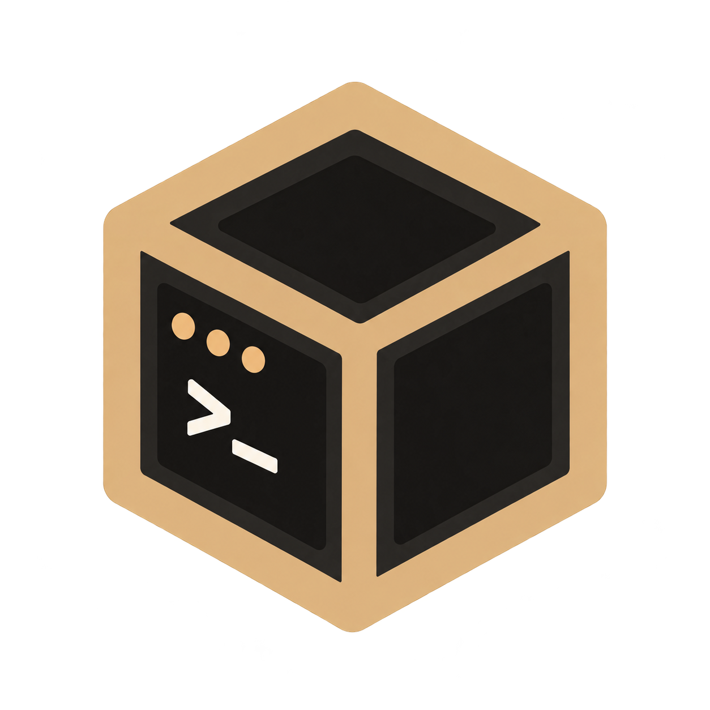
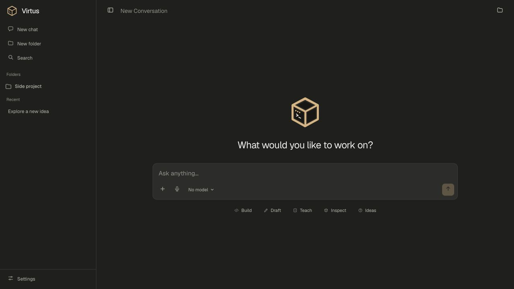
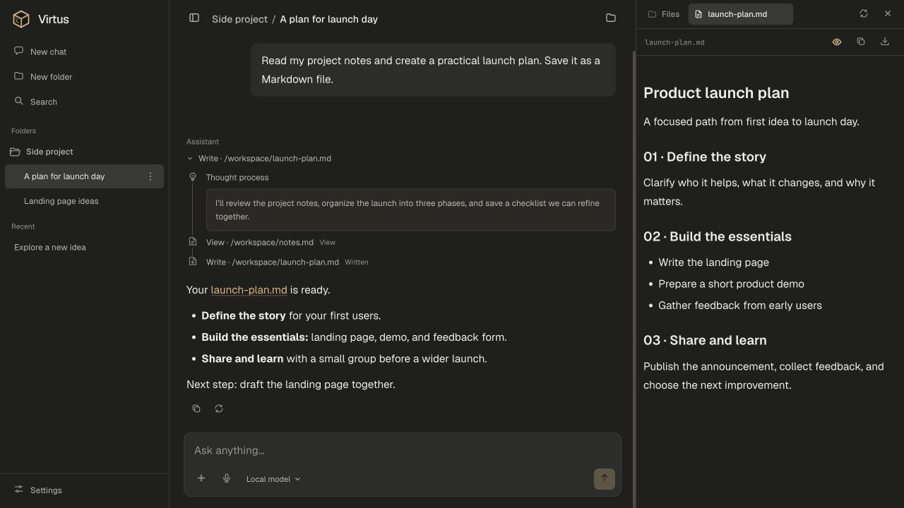
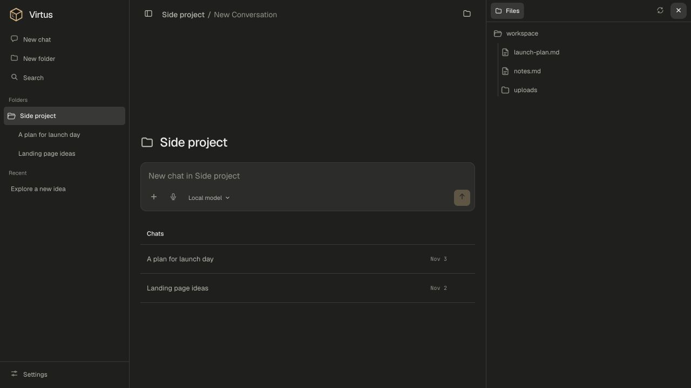
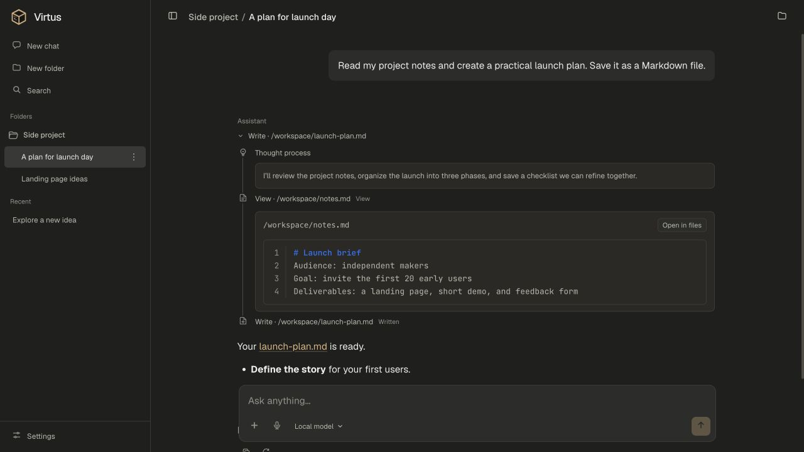
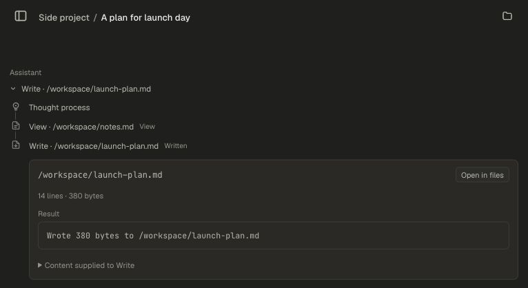
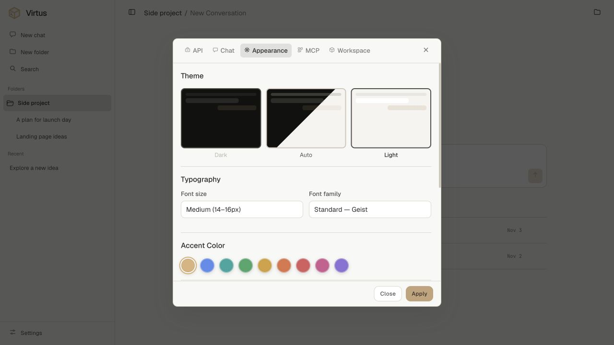
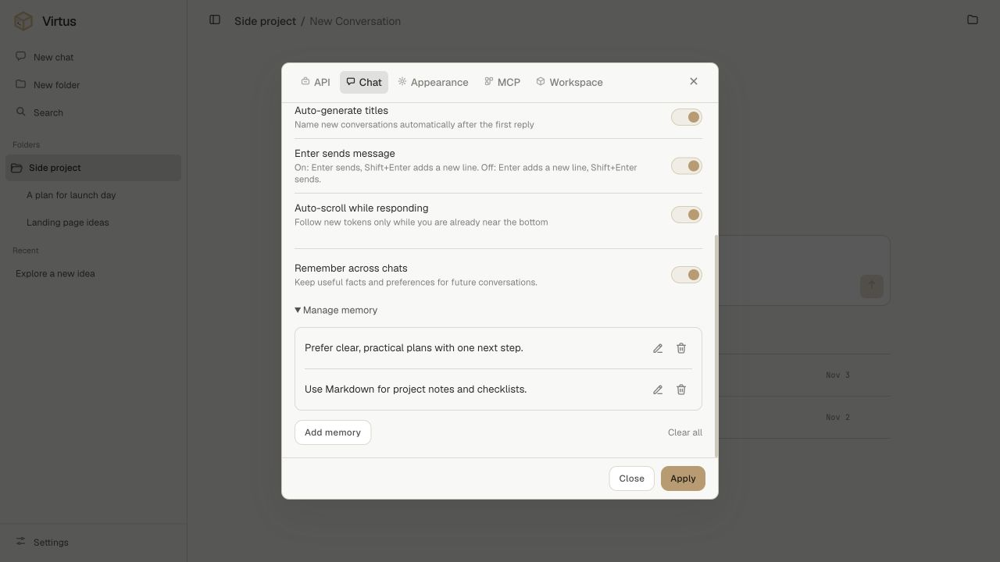

  <picture>
    <source media="(prefers-color-scheme: dark)" srcset="static/virtus-logo-dark.png" />
    <source media="(prefers-color-scheme: light)" srcset="static/virtus-logo-light.png" />
    
  </picture>

<h1 align="center">Virtus AI Chat</h1>

<strong>AI chat, with a computer of its own.</strong>

  Bring your model. Give it a workspace. Make something worth keeping.

  <a href="https://github.com/yossifibrahem/lumen-ai-chat/releases">Download</a> ·
  <a href="docs/SETUP.md">Get started</a> ·
  <a href="devs.md">Developer guide</a>

<em>The current Virtus interface. Screenshots throughout use example data.</em>

Virtus is a desktop AI workspace for thinking, writing, and building. Chat with a model you choose, let it work with files and run code in its own Docker environment, and keep everything organized around your projects.

## From conversation to creation

Ask for an explanation, shape a draft, explore a dataset, or build a small prototype. Virtus brings the conversation, tool activity, and workspace files into one interface.

| | What you can do |
| --- | --- |
| **Give ideas a workspace** | Let your model run commands, read files, and create or edit work inside a Docker sandbox. |
| **Keep a project together** | Group chats into folders with shared files and instructions, while each conversation keeps its own history. |
| **See what you make** | Browse files and preview Markdown, HTML, images, PDFs, code, and saved notebook outputs beside the chat. |
| **Choose your model** | Connect an OpenAI-compatible provider, including Ollama or LM Studio, and switch models from the composer. |
| **Carry context forward** | Use optional memory across chats, with controls to inspect, edit, clear, or disable it. |
| **Add your own tools** | Connect MCP servers and choose whether their tool calls need approval. |

## A little more room to think

| | What you can do |
| --- | --- |
| **Follow replies live** | Read responses as they stream, stop when you need to, and return to an in-progress reply after switching chats. |
| **Explore another direction** | Edit a message, regenerate an answer, and switch between conversation branches. |
| **Bring files and images** | Attach files from the composer and send images to vision-capable models. |
| **Read rich answers** | Work with Markdown, highlighted code, and rendered math; copy messages or code blocks when you need them. |
| **See the work happen** | Inspect tool arguments and results inline, with expandable thinking and tool activity. |
| **Find your way back** | Search chats and folders, rename or move conversations, and let Virtus generate chat titles. |
| **Make it yours** | Choose light, dark, or automatic themes, accent colors, fonts, and how thinking and tool blocks are displayed. |
| **Speak your prompt** | Use voice input where your browser supports it, and choose your preferred Enter-to-send behavior. |

## Take a look around

Click a screenshot to view it at full size.

<table>
  <tr>
    <td width="50%">
      
      
<strong>Chat and file previews</strong>

    </td>
    <td width="50%">
      
      
<strong>A home for each project</strong>

    </td>
  </tr>
  <tr>
    <td width="50%">
      
      
<strong>Thinking and tool activity</strong>

    </td>
    <td width="50%">
      
      
<strong>Tool calls in detail</strong>

    </td>
  </tr>
  <tr>
    <td width="50%">
      
      
<strong>Your space, your style</strong>

    </td>
    <td width="50%">
      
      
<strong>Memory you can manage</strong>

    </td>
  </tr>
</table>

## Your workspace stays with you

Chats, settings, memory, and workspace files are stored on your computer. Model requests go to the provider you connect; choose a local provider when you want local inference. Connected tools may also access external services.

Standalone chats have separate workspaces. Chats in a folder share one. The model's commands run inside Docker, and files enter the workspace through explicit uploads.

## Start something

Desktop builds target **Apple Silicon Macs with macOS 14+** and **Windows x64**. Virtus opens in your browser and stays available from the menu bar or system tray.

1. Install and start [Docker Desktop](https://www.docker.com/products/docker-desktop/).
2. Get the build for your platform from [GitHub Releases](https://github.com/yossifibrahem/lumen-ai-chat/releases) and follow the [installation guide](docs/SETUP.md).
3. Complete the in-app setup, connect your model provider in Settings, and start a chat.

The first setup needs internet access. You'll need a compatible model provider; available capabilities depend on the model you choose.

---

**Explore further:** [Installation & builds](docs/SETUP.md) · [Using Virtus](docs/USAGE.md) · [Configuration](docs/CONFIGURATION.md) · [Development](devs.md) · [Architecture decisions](ARCHITECTURE-DECISIONS.md)
