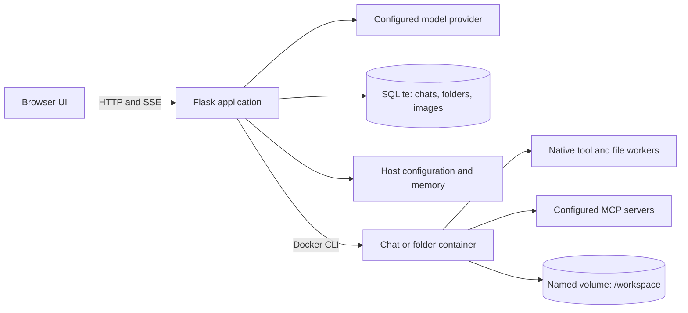

# Virtus technical reference

[Showcase](../README.md) · [Setup and builds](SETUP.md) · [Configuration](CONFIGURATION.md) · [Usage](USAGE.md)

This reference describes the implementation, development workflow, and operational
constraints of the current source tree. Installation instructions and the full
environment-variable reference live in the guides linked above.

## Architecture

Virtus serves a browser interface from Flask. The host process owns provider
credentials, conversation storage, streaming state, approvals, and Docker
lifecycle management. Model commands and configured MCP server processes run in
Linux containers. The host calls the configured OpenAI-compatible provider.



The frontend uses JavaScript ES modules and modular CSS served directly from
`static/`; it has no required frontend compilation step. Desktop packages run the
same Flask application with Waitress and open the default browser. macOS uses
`rumps` for its menu-bar host; Windows uses `pystray` for its notification-area host.

### Backend code map

| Source | Responsibility |
| --- | --- |
| [app.py](../app.py) | App factory, blueprint registration, startup cleanup, idle reaper, shutdown hooks |
| [routes_startup.py](../routes_startup.py), [runtime_requirements.py](../runtime_requirements.py) | Setup screen, Docker/image checks, protected startup actions and streamed image installation |
| [request_security.py](../request_security.py) | Host checks, browser sessions, same-origin and CSRF enforcement |
| [routes_chat.py](../routes_chat.py) | Background turns, SSE replay, cancellation, approval and settings endpoints |
| [chat_turn_service.py](../chat_turn_service.py), [streaming.py](../streaming.py) | Model/tool loop, partial saves, provider streaming and SSE encoding |
| [routes_conversations.py](../routes_conversations.py), [store.py](../store.py) | Chat/folder CRUD, runtime ownership, transactional SQLite storage |
| [builtin_tools.py](../builtin_tools.py) | Server-owned native tool schemas, validation and dispatch |
| [sandbox_tools.py](../sandbox_tools.py) | Container-side View, Write and Edit implementations |
| [sandbox_runtime.py](../sandbox_runtime.py) | Shared runtime locks, bounded subprocess transport and cancellation |
| [container_service.py](../container_service.py), [docker_cli.py](../docker_cli.py) | Docker command resolution, runtime specification, lifecycle and idle cleanup |
| [routes_files.py](../routes_files.py), [container_files.py](../container_files.py), [sandbox_files.py](../sandbox_files.py) | File HTTP endpoints, host transport and container-side path validation |
| [mcp_adapters.py](../mcp_adapters.py), [mcp_service.py](../mcp_service.py) | Container process wrapping, MCP configuration, discovery and pool ownership |
| [mcp_session_pool.py](../mcp_session_pool.py) | Persistent stdio sessions on a dedicated async worker |
| [tool_approval.py](../tool_approval.py), [tool_media.py](../tool_media.py) | Pending MCP approvals and chat-owned tool images |
| [memory_service.py](../memory_service.py), [storage_safeguards.py](../storage_safeguards.py) | Versioned global memory and sandbox storage checks |
| [app_config.py](../app_config.py), [advanced_config.py](../advanced_config.py) | Provider credentials and runtime/file limits |
| [title_service.py](../title_service.py) | Optional model-generated chat titles |
| [build_info.py](../build_info.py), [desktop_runtime.py](../desktop_runtime.py) | Build metadata, sandbox identity, resource validation, logging and health probes |
| [desktop_launcher.py](../desktop_launcher.py), [windows_desktop_launcher.py](../windows_desktop_launcher.py) | Native desktop menus, single-instance ownership and web-server lifecycle |

### Frontend code map

| Source area | Responsibility |
| --- | --- |
| `static/js/app.js`, `state.js`, `api.js`, `request_security.js` | Boot sequence, shared state and HTTP/session plumbing |
| `static/js/chat*.js`, `stream_consumer.js`, `conversation_activity.js` | Turn payloads, sends, edits, branches, attachments and active-stream recovery |
| `static/js/conversations.js` | Chat/folder navigation and persistence |
| `static/js/renderer*.js`, `native_tools/`, `tool_adapters/` | Messages, thinking, tool results and tool-specific presentation |
| `static/js/file_panel.js`, `pdf_preview.js`, `source_view.js` | Workspace browsing and document/source previews |
| `static/js/settings.js`, `mcp.js`, `memory_settings.js`, `customization.js` | Provider, tool, memory and appearance controls |
| `static/js/app_policy.js`, `chat_payloads.js` | App guidance and model-message construction |
| `static/css/main.css`, `static/css/modules/`, `templates/` | Styling and Flask-rendered application/setup shells |

## Development and verification

Use Python 3.12 for development and desktop builds, with Docker running Linux
containers. Install Node.js locally if running JavaScript syntax checks. Host
Python dependencies and sandbox dependencies are separate: `requirements.txt`
installs the web application; `Dockerfile.sandbox` installs the model's tools.

From the repository root on macOS or Linux:

```bash
python -m venv .venv
source .venv/bin/activate
python -m pip install -r requirements-dev.txt
identity="$(python -c 'import build_info; print(build_info.sandbox_identity())')"
docker build --build-arg "VIRTUS_SANDBOX_IDENTITY=$identity" \
  -f Dockerfile.sandbox -t virtus-sandbox:latest .
python app.py
```

On Windows, activate the environment with `.venv\Scripts\Activate.ps1` and use
PowerShell syntax for environment variables and command continuation. The source
server defaults to `127.0.0.1:8080`; desktop launchers default to loopback port
`38492`. Missing Docker requirements show a setup screen instead of terminating
Flask. Starting Docker or building the image from that screen requires an explicit
user action.

Run the regular checks without real provider or Docker dependencies:

```bash
python -m pytest
find static/js -name '*.js' -print0 | xargs -0 -n1 node --check
git diff --check
```

The default suite uses temporary storage and mocked external transports. MCP tests
also exercise SDK discovery, calls and cancellation against a disposable local
stdio server. Real Docker integration is opt-in:

```bash
identity="$(python -c 'import build_info; print(build_info.sandbox_identity())')"
docker build --build-arg "VIRTUS_SANDBOX_IDENTITY=$identity" \
  -f Dockerfile.sandbox -t virtus-sandbox:builtins-test .
VIRTUS_RUN_DOCKER_TESTS=1 python -m pytest tests/test_builtin_docker.py
python packaging/smoke_sandbox.py --image virtus-sandbox:builtins-test
```

These checks create disposable Docker resources. Image builds and package-install
integration tests need access to package registries. The smoke script verifies
Python dependencies and workspace persistence across separate container runs.

## Runtime ownership and lifecycle

`store.runtime_id()` resolves a standalone chat to its chat ID and a folder chat
to `folder_<folder_id>`. Runtime IDs identify containers, named volumes, operation
locks and persistent MCP pools. Chat IDs identify histories, streams and images.

| Operation | Workspace behavior |
| --- | --- |
| Create a standalone chat | Its runtime gets a dedicated named volume when provisioned |
| Open chats in the same folder | All use the folder runtime and `/workspace`, with separate histories |
| Edit/regenerate messages or switch branches | Files and the container environment retain their current state |
| Move a chat | The runtime changes; files are not copied to the destination |
| Move a standalone chat into a folder | The old standalone runtime/workspace is removed through the confirmed move path |
| Remove or move the last chat out of a folder | The folder retains its workspace |
| Delete a folder | Its chats and owned runtime/workspace are removed |
| Recreate a container | The named volume survives; packages/files in the container's writable layer do not |

Container names default to `virtus-chat-<runtime_id>`; their volumes are named
`<container_name>-workspace` and mounted read/write at `/workspace`. Deletion
confirms Docker cleanup before removing saved chat/folder metadata. A cleanup
failure leaves saved data available and reports the failure.

### Reuse and reconciliation

`container_service.ensure_container()` serializes creation and reuse. Its shared
`RuntimeSpec` checks the configured image reference, actual image ID, sandbox
identity labels, workspace mount, working directory and effective security/resource
configuration. Defaults include:

- Container root (`0:0`), private IPC and cgroup namespaces.
- 512 MiB memory, one CPU and a 256-process limit.
- All capabilities dropped, with only `CHOWN`, `DAC_OVERRIDE`, `SETUID` and
  `SETGID` added back; `no-new-privileges` enabled.
- One managed workspace mount, without host directories or the Docker socket.

Equivalent root names/IDs are accepted during reuse. Unexpected mounts, devices,
privileged settings or incompatible namespaces require recreation. An active
shared operation prevents recreation and returns a retry error. Removal failure
aborts recreation.

Networking is delegated to Docker: creation supplies no network-mode flag, and
reconciliation excludes network attachments. Normal outbound access is expected;
obsolete saved network controls do not define runtime policy.

Native tools, file operations and MCP calls serialize through the same runtime
lock. The idle reaper takes that lock without waiting, rechecks activity, and stops
idle containers after 600 seconds by default; `0` disables reaping. Stopped
containers remain reusable. Successful stops invalidate MCP pools; failed stops
retain activity/pool state for a later retry. MCP discovery uses a separate
`mcp-discovery` runtime that is stopped after discovery.

Startup removes stale containers while retaining known empty-folder runtimes.
Application shutdown closes MCP pools and stops running containers concurrently
within a shared deadline. The backend's default cleanup budget is 10 seconds;
Windows desktop Quit coordinates a 15-second overall deadline.

## Model turns, streaming and history

`POST /api/chat/stream` starts a background turn or attaches to an active stream.
Only one turn may run per conversation. Stream ownership is tied to the browser
session; cancel and approval requests must belong to that session.

The frontend captures the turn's folder and custom instructions before async work.
A nonempty folder prompt takes precedence over the global custom prompt for that
folder. `app_policy.js` supplies app/workspace guidance, tool schemas describe tool
contracts, and attachment paths are attached to their user messages. Branches share
the current runtime; message history cannot roll back filesystem changes.

Each turn creates and closes a provider client, injects current enabled memory,
adds native tools, streams a response, executes tool calls, and repeats until
completion or cancellation. Provider credentials come from server configuration.
Provider calls disable automatic retries. Images remain small references in saved
messages and browser payloads; Flask expands them at the provider boundary.

`TurnRecorder` saves partial output at most once every 0.75 seconds, with forced
writes at tool boundaries and finalization. Every emitted tool call receives a
matching result, including validation failures, denied approvals and cancellation.
Malformed arguments fail before execution. Errors retain partial output and clear
the active-stream marker. Final history is saved before `assistant_done`; a manual
title rename takes precedence over background title generation.

Active SSE events are encoded once and replayed from process memory when the UI
reattaches. Resolved approval prompts become comments without shifting replay
positions. Keep-alives are emitted while waiting, and `[DONE]` terminates the HTTP
stream. The browser continues consuming events while approvals are pending and
keeps the composer busy until stream completion.

**Run one application worker process.** Cancellation, approvals and active replay
are process-local. `gunicorn.conf.py` selects one worker with four threads; desktop
Waitress also runs in one process. SQLite persists history, but active turns and
replay buffers do not survive a process restart. There is no external job queue or
cross-process stream broker.

Replay exhaustion cancels the turn and emits `history_reload` so the UI can fetch
authoritative saved state. Recovery requires both message and display-log arrays.
Pending recovery blocks new sends, edits and history/branch saves to prevent stale
state from overwriting recovered data.

## Native tools and file transport

The server owns `bash`, `view`, `write` and `edit` schemas; `update_memory` is added
when memory is enabled. These names are reserved against MCP collisions. Native
tools execute automatically within the request; MCP approval settings are separate.

| Tool | Contract |
| --- | --- |
| `bash` | Fresh noninteractive Bash at `/workspace`; 120-second default and 600-second maximum timeout; output capped at 32 KiB |
| `view` | Container paths; text up to 200 lines/32 KiB, two-level directory listings up to 200 entries, images, up to five PDF pages, or saved notebook cells without execution |
| `write` | Create or overwrite UTF-8 text and parent directories, up to 1 MiB |
| `edit` | Exact replacement in a file up to 1 MiB; one match unless `replace_all=true`, with a fingerprint check before replacement |
| `update_memory` | Version-checked replacement of the enabled app-owned memory store |

Relative native-tool paths start at `/workspace`; absolute paths refer to the
container filesystem. Native tools can access other container paths and install
packages. Bash shell state does not persist between calls. A supervisor removes
background descendants after the shell exits. Timeout, cancellation, abnormal
termination or retained pipes may stop the shared runtime and interrupt other
chats in the folder; workspace files remain in the volume.

The file panel is confined to `/workspace`. `sandbox_files.py` resolves paths
inside Docker, rejects traversal, escaping symlinks and special files, and bounds
reads. Host code must never follow container-created symlinks to implement file
operations. Explicit uploads enter `/workspace/uploads/`.

File previews default to 512 KiB, with a 4 MiB ceiling. Listings default to 500
entries, with a 5,000-entry ceiling. Uploads and downloads have a 50 MiB per-file
ceiling; uploads can use a smaller configured limit. Flask's default aggregate
request-body cap is 60 MiB. Native `view` limits and file-panel limits are separate.

Uploads, downloads and PDF ranges use bounded JSON metadata followed by raw
bytes. Visual previews use bounded JSON/base64 transport. Transfers are buffered;
they are not unbounded streaming file transfers. Upload metadata and bodies are
passed separately to reduce copies.

## Persistence, configuration and memory

### SQLite and images

`store.py` uses standard-library `sqlite3`, one connection per operation, foreign
keys, WAL journaling and short transactions. Schema version 2 contains:

| Table | Contents |
| --- | --- |
| `folders` | Folder IDs, names, prompts and timestamps |
| `conversations` | Chat metadata, folder ownership and active-stream IDs |
| `conversation_entries` | Ordered `messages` and `displayLog` JSON entries |
| `images` | Chat-owned image references, MIME types and binary bytes |

Indexed sidebar queries avoid loading histories. Snapshot saves compare serialized
entries, write changed/new rows and remove truncated suffixes. Metadata edits merge
inside a write transaction; background saves cannot recreate deleted chats. Folder
deletion cascades through chats, histories and images after successful runtime
cleanup. Database and Docker cleanup are separate operations, with Docker cleanup
ordered first.

The image table is added automatically to existing version-1 databases. Legacy
conversation/folder JSON files and file-based images are not imported. Draft image
previews stay local; sending creates the chat before uploading image bytes to its
image endpoint. Workspace copies of images remain ordinary volume files.

### Configuration and backup

Provider credentials, MCP configuration, advanced limits and memory live under
`~/.virtus/`, alongside `virtus.sqlite3`. The complete file layout and override
variables are in [Configuration](CONFIGURATION.md#persistent-data). JSON settings
use atomic replacement and synchronized cached reads; callers receive independent
snapshots. Environment variables take precedence over saved values and defaults.
Advanced configuration reports which values are environment-locked.

API keys stay on the server. The settings response exposes `has_api_key` rather
than the credential. Browser-local preferences include appearance and MCP
enablement/approval/icon settings; these do not replace the server's MCP command
configuration.

For an offline backup, stop Virtus before copying `~/.virtus/` and back up Docker
workspace volumes separately. A live database backup must use SQLite's backup API;
copying only `virtus.sqlite3` while WAL writes are active can omit recent changes.
Database backups include chat-owned images, while workspace files remain in Docker.

### Global memory

Memory defaults to enabled. `memory_service.py` owns `memory.json`, containing a
string `content` field, with a 32 KiB UTF-8 limit. Revisions are SHA-256 hashes;
updates use a process-wide lock, revision comparison and atomic replacement.
`memory.history.json` retains up to eight prior versions, and
`memory.settings.json` stores enablement. Explicitly clearing oversized memory
preserves a copy in `memory.oversized.json`.

Each provider request rechecks enablement and injects a fresh content/revision
snapshot as remembered data subordinate to application and user instructions.
Disabled requests read no memory and receive no memory tool. `update_memory`
rechecks enablement at invocation; revision conflicts return current content for
merging. Disabling memory leaves existing saved history and stored memory intact.
Canonical memory is never mounted into containers, and toggling memory does not
change runtime identity.

## MCP integration

Configure servers through settings or `~/.virtus/mcp.json`; see the
[configuration example](CONFIGURATION.md#mcp-configuration). Virtus does not bundle
or automatically register an MCP server. Commands, scripts and paths in server
definitions must exist inside the active container.

`mcp_adapters.py` wraps configured commands in `docker exec` at `/workspace`. Only
explicit server environment values and `PWD=/workspace` are forwarded through
that wrapper; the host Docker client uses the host environment. Tildes in values
remain literal, so use absolute container paths where required.

Model-facing tools keep their original names; `mcp_tool_meta` carries the matching
server and approval preference separately. Reserved native names cause discovery
or turn validation to fail rather than shadowing a built-in. Per-server browser
preferences live under `virtus_mcp_server_settings` in `localStorage`.

Persistent pools belong to a runtime and reuse stdio sessions across turns. MCP's
AnyIO contexts must open, initialize, invoke and close in the same async task.
`McpSessionPool` preserves this with one worker coroutine, an `asyncio.Queue` and
`loop.call_soon_threadsafe()` for synchronous callers. Replacing it with one task
per operation would break context ownership and cleanup.

Sessions are replaced when explicit command, arguments or environment change.
Partial initialization closes opened resources; contexts close in reverse order.
Transport failures discard the failed session without automatically retrying a
potentially side-effecting call. A later request may open a new session. Runtime
stops invalidate pools. Cancellation unwinds contexts in their owning task and can
stop the shared container when necessary.

## Resource limits and request protection

| Limit | Default or fixed ceiling |
| --- | --- |
| Turn duration / total tool calls | 900 seconds / 100 calls, configurable |
| Minimum sandbox free space | 512 MiB, configurable |
| Managed workspace size | 10 GiB, configurable |
| Provider request timeout | 120 seconds, environment override |
| MCP tool timeout / approval wait | 120 seconds / 600 seconds, environment overrides |
| Model output per turn | 2 MiB |
| Tool calls per provider batch | 128 |
| Parsed tool argument JSON | 3 MiB before tool-specific validation |
| MCP text result | 64 KiB |
| Active SSE replay | 8 MiB before cancellation and history recovery |

Storage probes execute inside Docker, measure workspace usage without following
symlinks, and check free space on the volume and container filesystem. Failed
probes block normal execution. Turns and tool operations recheck storage while
running, approximately every two seconds where supported. These checks are
best-effort safeguards rather than filesystem quotas.

Known file-panel list, preview, download and PDF read actions use a request-local
recovery context to remain available above storage limits. Uploads, Bash, MCP and
ordinary turns continue to enforce growth checks. The recovery context resets on
errors and does not propagate to unrelated threads.

The application is designed for trusted local use. `request_security.py` checks
allowed hosts, rejects cross-origin/cross-site requests, requires an initialized
browser session for `/api/`, and checks `X-Virtus-CSRF` on mutating API requests.
Session cookies are HTTP-only with `SameSite=Strict`. Responses include content
type, frame and referrer protections. Startup actions additionally validate a
short-lived session token and the exact loopback origin.

macOS can explicitly enable local-network access and persist it in
`desktop-network.json`. This exposes the local application to the selected network;
there is no separate multi-user authentication or authorization model. Docker
isolation, request protection and resource limits have distinct responsibilities.

## Sandbox identity and desktop packaging

The sandbox is Ubuntu 24.04 with Bash, Python in `/opt/venv`, Node.js 22, common
command-line utilities, data/document Python packages and the optional
`mcp-remote` bridge. `Dockerfile.sandbox` is the source of truth for dependencies.
Container workers are copied to `/opt/virtus/`; the default command keeps the
container running for subsequent exec operations.

`build_info.sandbox_identity()` computes a SHA-256 over `.dockerignore`,
`Dockerfile.sandbox`, `sandbox_tools.py` and `sandbox_files.py`, including relative
paths and normalized newlines. A worker or Docker build-input change requires an
image rebuild. Desktop version, icon and documentation changes do not invalidate
the image. Image names without an explicit tag are canonicalized to `:latest`.

Startup checks distinguish missing/outdated images from Docker or inspection
failures. The installer retains only the last 50 diagnostic lines, bounded to
8 KiB per line, and releases its build lock on failure. Frozen-resource validation
checks templates, assets and the complete sandbox build context.

Install `requirements-desktop.txt` before desktop packaging. Build scripts and
PyInstaller specifications live in [packaging/](../packaging/):

| Target | Build and lifecycle details |
| --- | --- |
| macOS | `packaging/build_macos.sh`; Apple Silicon app/DMG, macOS 14 minimum; ad-hoc signing by default or `MACOS_SIGN_IDENTITY`; menu-bar host with a file lock |
| Windows | `packaging/build_windows.ps1`; requires Python 3.12 x64; windowed PyInstaller `onedir` ZIP plus SHA-256; tray host with a named mutex |

Windows distributions must include the complete `onedir` directory. Docker
subprocesses use windowless creation flags. Frozen GUI processes can have no
`sys.stderr`, so MCP logging requires a valid writable target held open for the
subprocess lifetime. Cleanup runs outside the tray callback and keeps the tray
icon until shutdown completes; Windows has a bounded final-exit watchdog.

The Windows build extracts the produced ZIP and runs smoke mode against the
extracted executable. Both desktop launchers support `VIRTUS_DESKTOP_SMOKE_TEST=1`
and `VIRTUS_DESKTOP_NO_BROWSER=1`. Desktop logs are written to
`~/.virtus/logs/virtus.log`.

[release.yml](../.github/workflows/release.yml) builds and smoke-tests sandbox
images for Linux amd64/arm64, runs platform tests, and packages macOS/Windows
artifacts. Optional macOS signing/notarization uses configured release secrets.
Tag-triggered releases attach generated artifacts. See
[Setup and builds](SETUP.md#building-and-deploying) for platform commands.
